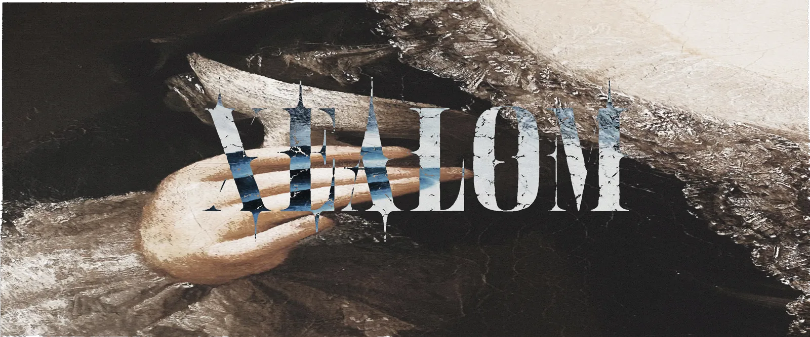

<table>
<tr>
<td valign="top">

$ whoami --recent

<!-- ACTIVITY starts -->
- [Malte-Dzierzon/dotfiles](https://github.com/Malte-Dzierzon/dotfiles) — Revise README for clarity and updates ([e1533b4](https://github.com/Malte-Dzierzon/dotfiles/commit/e1533b4014a565a2e36228513c4fd9bcc5863260)) — 2026-10-11
- [Malte-Dzierzon/dotfiles](https://github.com/Malte-Dzierzon/dotfiles) — docs: stack-first README with collapsible sections ([f63aee3](https://github.com/Malte-Dzierzon/dotfiles/commit/f63aee34859c1fd4c05d46bdbce8d0a11255c4d7)) — 2026-10-11
- [Malte-Dzierzon/dotfiles](https://github.com/Malte-Dzierzon/dotfiles) — docs: restore shield banners in README ([a587fdb](https://github.com/Malte-Dzierzon/dotfiles/commit/a587fdb28d1abf9884641b892e48ad909a72c8af)) — 2026-10-11
- [Malte-Dzierzon/dotfiles](https://github.com/Malte-Dzierzon/dotfiles) — fix: launcher keys use noctalia panel-toggle, not walker ([6289bf5](https://github.com/Malte-Dzierzon/dotfiles/commit/6289bf5b9fc8b7517129edd758caabbbeaa012c0)) — 2026-10-11
<!-- ACTIVITY ends -->

</td>
</tr>
<tr>
<td valign="top">

$ ls --featured

<!-- REPOSITORIES starts -->
- [dotfiles](https://github.com/Malte-Dzierzon/dotfiles) — my personal system setup — 2026-10-11
- [Informatik-Projekt-August-Malte](https://github.com/Malte-Dzierzon/Informatik-Projekt-August-Malte) — Training a neural network to recognize pyramids based on the vertices (2 ★) — 2026-09-01
- [omarchy-haven-theme](https://github.com/Malte-Dzierzon/omarchy-haven-theme) — Dark all-round Omarchy theme with a muted, readable palette that fits many wallpapers — 2026-09-06
<!-- REPOSITORIES ends -->

</td>
</tr>
</table>

- [Discord](https://discord.com/user/1029271091899809852)
- [Steam](https://steamcommunity.com/id/xealom/)
- [YouTube](https://www.youtube.com/@Xealom)
- [TikTok](https://www.tiktok.com/@maltedz)
