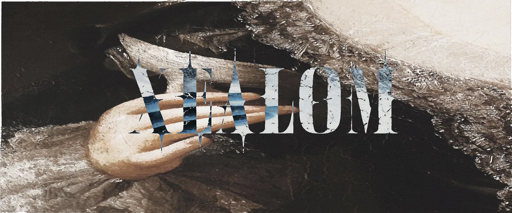

<table>
<tr>
<td valign="top">

xealomlinux~ git log -4

<!-- ACTIVITY starts -->
- [Malte-Dzierzon/dot-files](https://github.com/Malte-Dzierzon/dot-files) — umbriel: Mod+Shift+D opens Resources, Mod+M opens KittyTune ([9a220e0](https://github.com/Malte-Dzierzon/dot-files/commit/9a220e0003f3fd9eeafa4ab62e63d6e77e6d1d12)) — 2026-11-13
- [Malte-Dzierzon/dot-files](https://github.com/Malte-Dzierzon/dot-files) — Drop redundant Apps section, remove kew and cava from App-Liste ([1d54822](https://github.com/Malte-Dzierzon/dot-files/commit/1d54822968a0d99b68b154b556f191383419abc7)) — 2026-11-12
- [Malte-Dzierzon/wenyi](https://github.com/Malte-Dzierzon/wenyi) — chore(repo): sync main with local tree, drop retired stacks ([35d03b2](https://github.com/Malte-Dzierzon/wenyi/commit/35d03b22065250d15ae73afff12f31fbdbed26cf)) — 2026-11-10
- [Malte-Dzierzon/wenyi](https://github.com/Malte-Dzierzon/wenyi) — feat(engine): slice 4 one-book translation parity in wenyi-core ([d8ed3ee](https://github.com/Malte-Dzierzon/wenyi/commit/d8ed3eeb5a8c14bbb2dcba2d448a52e1392ab8c8)) — 2026-11-10
<!-- ACTIVITY ends -->

</td>
</tr>
<tr>
<td valign="top">

xealomlinux~ eza ~/projects

<!-- REPOSITORIES starts -->
- [dot-files](https://github.com/Malte-Dzierzon/dot-files) — my personal used linux setup — 2026-11-14
- [Informatik-Projekt-August-Malte](https://github.com/Malte-Dzierzon/Informatik-Projekt-August-Malte) — Training a neural network to recognize pyramids based on the vertices (2 ★) — 2026-10-29
- [omarchy-haven-theme](https://github.com/Malte-Dzierzon/omarchy-haven-theme) — Dark all-round Omarchy theme with a muted, readable palette that fits many wallpapers — 2026-09-06
<!-- REPOSITORIES ends -->

</td>
</tr>
</table>

-> [Social Media Links](https://drift.rip/Xealom)
